<div align="center">

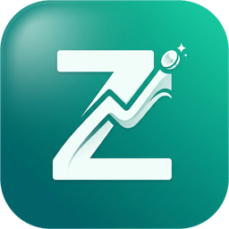

# ZCashflow

**Your finances. Local, private, on all your devices.**

A local-first personal finance app for Windows, macOS, Linux, Android and iPhone –
no cloud, no account, no tracking. Your devices sync with each other, end-to-end
encrypted, over your own Wi-Fi.

<p>
  <a href="https://github.com/TheHolyOneZ/ZCashflow/releases/latest"></a>
  <a href="LICENSE"></a>
  
  
  <a href="https://ko-fi.com/theholyonez"></a>
</p>

<p>
  <a href="#-download"><b>Download</b></a> ·
  <a href="#-features"><b>Features</b></a> ·
  <a href="#-installation"><b>Installation</b></a> ·
  <a href="#-iphone--ipad-ios"><b>iPhone guide</b></a> ·
  <a href="#-sync-between-devices"><b>Sync</b></a> ·
  <a href="#-build-from-source"><b>Build from source</b></a> ·
  <a href="#-faq--troubleshooting"><b>FAQ</b></a> ·
  <a href="https://zsync.eu/zcashflow/"><b>Website</b></a>
</p>

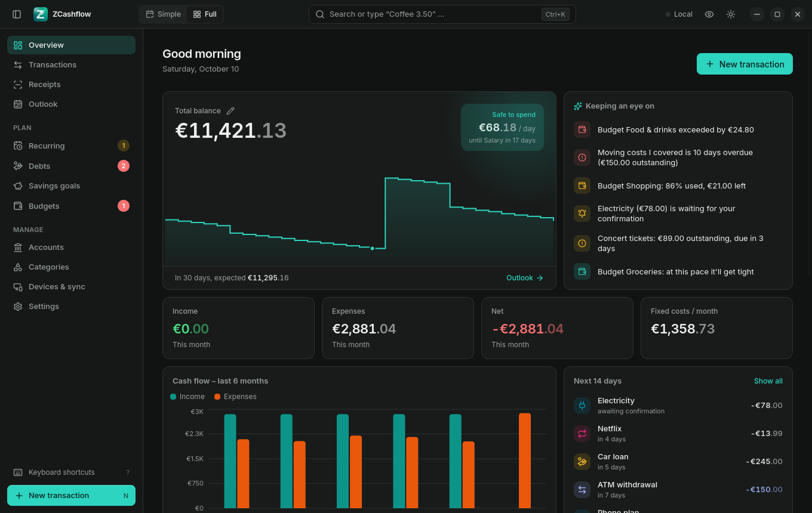

</div>

---

## Contents

- [What's new in 1.3.0](#-whats-new-in-130)
- [Why ZCashflow?](#-why-zcashflow)
- [Features](#-features)
- [Screenshots](#-screenshots)
- [Download](#-download)
- [Installation](#-installation)
  - [Windows](#-windows) · [macOS](#-macos-apple-silicon) · [Linux](#-linux) · [Android](#-android) · [iPhone & iPad](#-iphone--ipad-ios)
  - [Verify your download](#-verify-your-download)
- [First steps](#-first-steps)
- [Sync between devices](#-sync-between-devices)
- [Receipts, OCR & local AI](#-receipts-ocr--local-ai)
- [Your data](#-your-data)
- [Keyboard shortcuts](#-keyboard-shortcuts)
- [Build from source](#-build-from-source)
- [FAQ & troubleshooting](#-faq--troubleshooting)
- [Contributing](#-contributing)
- [License, author & support](#-license-author--support)

---

## 🆕 What's new in 1.3.0

- **Totals in the transactions list** – income, expenses and net at the top for whatever the filters select (all, an account, a category, a period), and each day's income and expenses in its header.
- **Time of day** – entries made today get the current time automatically; change or remove it in the dialog. Shown in the list and used to sort each day. Receipts are booked with the time printed on them, and CSV import/export carry a time column.
- **Recurring payments with a time** – e.g. salary at 09:00: it's booked with that time, once the time has passed on the due day.

The database gets optional time columns; the sync schema is unchanged, so 1.2.0 devices still sync – update all paired devices anyway.

### 1.2.0

- **Subcategories at any depth** – drag a category by its handle onto another one to nest it, or onto the drop zone to make it a main category. Budgets, filters and totals include every level.
- **Export everything** – all data or a selection (transactions, accounts, categories, recurring payments, budgets, goals, debts) for any period, as CSV or one ZIP. *Excel (;)* format for European Excel.
- **CSV import** – from the ZCashflow template or straight from your bank's export (`Buchungstag`, `Betrag`, `-1.234,56` …), with a preview of duplicates and errors before anything is saved.
- **Receipt line items** – give each item its own category; booking creates one entry per category, all linked to the same photo. PDF scans from phone scanner apps work too.
- **Forecast per account** – show selected accounts only, or one curve per account.
- **Budgets in the plan** – include all or selected budgets in the month plan, forecast and safe-to-spend.
- **Window controls** stay available in narrow windows; <kbd>F11</kbd> toggles full screen.
- Fixed: importing a receipt on Android failed with "expected raw image bytes".

No database or sync schema change. Older versions sync as before but don't show categories below the second level – update all paired devices.

See [changelog.md](changelog.md) for the full change list.

---

## 💡 Why ZCashflow?

|  |  |
|---|---|
| 🔒 **Private by design** | Everything is stored in a local SQLite database on your device. There is no server, no account, no analytics, no ads. |
| 🔁 **All your devices, in sync** | PC, laptop and phone sync live and end-to-end encrypted (Noise protocol) – only inside your own network, never through a cloud. |
| 🔮 **Knows what's coming** | Recurring payments, installments and savings goals feed a forecast: how much you'll have at the end of the month and how much you can safely spend per day. |
| 🧾 **Receipts that type themselves** | Snap a receipt – date, total and merchant are recognized on the device. Optionally refined by a local AI model. |
| ⚡ **Two minutes a day** | The *Simple* view is built for a daily routine: enter today's spending, drop today's receipts, done. |
| 🎨 **Yours** | Light, dark and midnight themes, 9 accent colors, 4 fonts, density, corner style, size, a privacy blur – and 7 languages. |

---

## ✨ Features

<table>
<tr>
<td width="50%" valign="top">

### 📊 Overview & forecast
- Total balance with a **30-day balance forecast** chart – all accounts, a selection, or one curve per account
- **Safe to spend per day** until your next income – calculated from spendable accounts only
- *Keeping an eye on*: overdue debts, exceeded budgets, low balance ahead, payments waiting for confirmation
- Monthly income, expenses, net and fixed costs
- Cash-flow chart for the last 6 months
- Every widget can be hidden; choose your start page

</td>
<td width="50%" valign="top">

### ⚡ Simple daily mode
- One screen for the daily routine – switch **Simple / Full** in the title bar
- Amount + short note → <kbd>Enter</kbd> → done (or just type `Coffee 3.50`)
- **Week strip** with spending per day and "done" marks
- **"Again" chips** – re-add your regular coffee or bakery visit with one tap
- **Catch up** a whole period day by day (this month, last 2–6 months or any date) – with progress bar and resume
- Streaks, evening reminder, "Done for today"

</td>
</tr>
<tr>
<td valign="top">

### 💳 Transactions
- Income, expenses and transfers between accounts, with an optional **time of day**
- **Quick entry** understands `Kebab 8.50`, `+2500 salary yesterday`, `Fuel 60€ 03.10.`
- Categories are **learned** from your history and recognized by keyword from the very first entry (`REWE`, `Aral`, `Netflix` …)
- **Subcategories at any depth**, rearranged by drag & drop
- **CSV import** from your bank's export or the ZCashflow template, with duplicate detection
- Full-text search incl. receipt text, filters by account, category, date range
- **Income, expenses and net** for the current filter, and per day in the list
- Tags, notes, references (`TX-2026-000123`), duplicate, right-click menus everywhere

</td>
<td valign="top">

### 🧾 Receipts
- Photo, file picker or drag & drop anywhere in the window
- On-device OCR (built-in `ocrs` everywhere, Tesseract on desktop if installed)
- Detects date, time, total, merchant and **line items**; finds the matching transaction
- **Split by category**: one receipt, one entry per category
- Photos and PDF scans
- One click: **book** the receipt or **link** it to an existing entry
- Optional **local AI** (Ollama, LM Studio …) refines values and suggests a category – nothing leaves your device

</td>
</tr>
<tr>
<td valign="top">

### 🔁 Recurring payments
- Salary, rent, subscriptions, insurance – weekly, monthly, every *n* months, yearly
- Booked **automatically** – optionally at a set time, e.g. salary at 09:00 – or **confirmed by you** for varying amounts
- Upcoming occurrences refresh every minute while their list is open, so payments that become due appear without restarting the app
- Pick *Repeat* right in the quick entry (e.g. insurance, twice a year)
- Got a bonus? Adjust this month's salary – or apply the new amount to all future months
- Fixed costs per month and per year at a glance

</td>
<td valign="top">

### 🎯 Debts, goals & budgets
- **Debts** in both directions with installment plans that stop by themselves and a projected payoff date
- **Savings goals** with target date, required monthly amount, your real pace and "on track / behind"
- **Budgets** per day, week, month or year with a projection to the end of the period and warnings from 80 %
- Include budgets in the month plan and forecast – all or a selection

</td>
</tr>
<tr>
<td valign="top">

### 🏦 Accounts
- Checking, cash, savings, credit card, other – multiple currencies
- *Where your money is* distribution bar
- **Correct balance** (pencil icon): enter the balance shown by your bank, including zero or a negative balance – earlier entries become history and later transactions continue to update it

</td>
<td valign="top">

### 🔗 Devices & sync
- Live sync between all your devices on the same Wi-Fi
- **Finds devices automatically** – even on iPhone, where Bonjour isn't available
- **One-tap pairing**: tap *Pair* on the phone, the PC shows a 6-digit code
- Roles per device: full access, read-only, receipts-only
- Receipt photos are transferred too
- Corrected balances sync independently from account name and color changes

</td>
</tr>
</table>

**Also included:** 7 languages (English, Deutsch, Español, Français, Italiano, Polski, Türkçe) · light / dark / midnight themes · accent colors, fonts, density, corner radius, interface size · privacy mode that blurs every amount (<kbd>Ctrl</kbd>+<kbd>Shift</kbd>+<kbd>H</kbd>) · custom title bar · command palette · system notifications · CSV / ZIP export and CSV import · full database backup · demo data to explore · factory reset with backup.

---

## 🖼 Screenshots

<table>
<tr>
<td width="50%">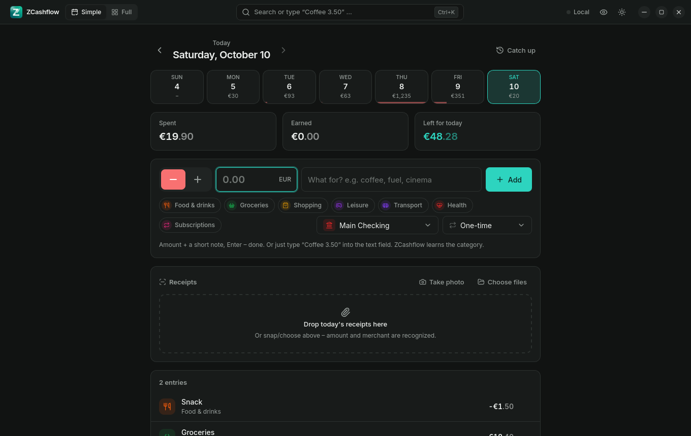<br/><sub><b>Simple view</b> – today's entries, week strip, quick entry, receipts</sub></td>
<td width="50%">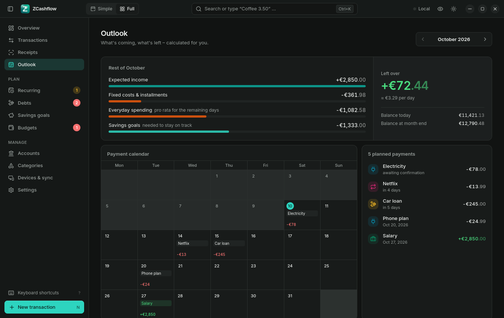<br/><sub><b>Outlook</b> – month plan, what's left, payment calendar</sub></td>
</tr>
<tr>
<td>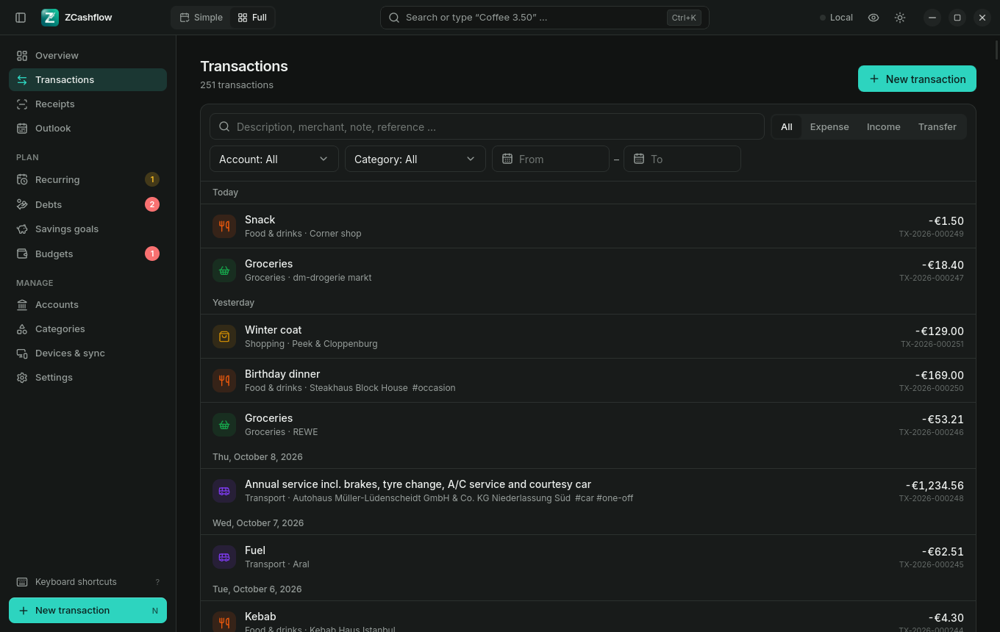<br/><sub><b>Transactions</b> – search, filters, grouped by day</sub></td>
<td>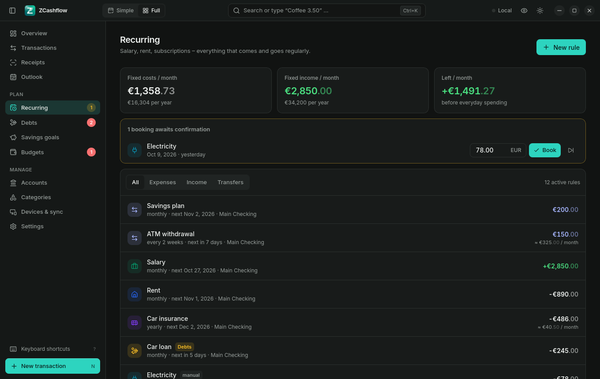<br/><sub><b>Recurring</b> – fixed costs, confirmations, all rules</sub></td>
</tr>
<tr>
<td>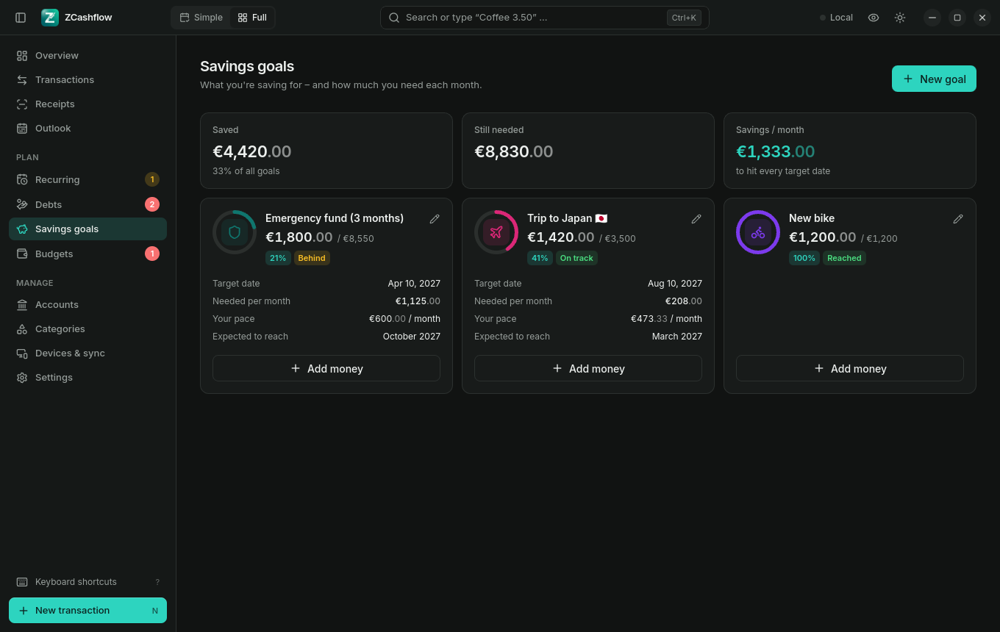<br/><sub><b>Savings goals</b> – pace, target date, monthly amount</sub></td>
<td>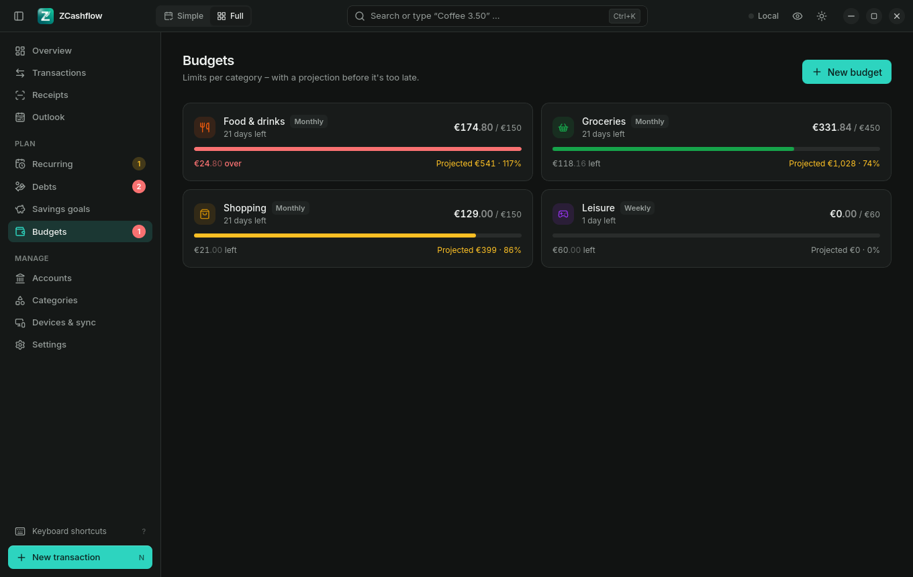<br/><sub><b>Budgets</b> – limits with projection</sub></td>
</tr>
<tr>
<td>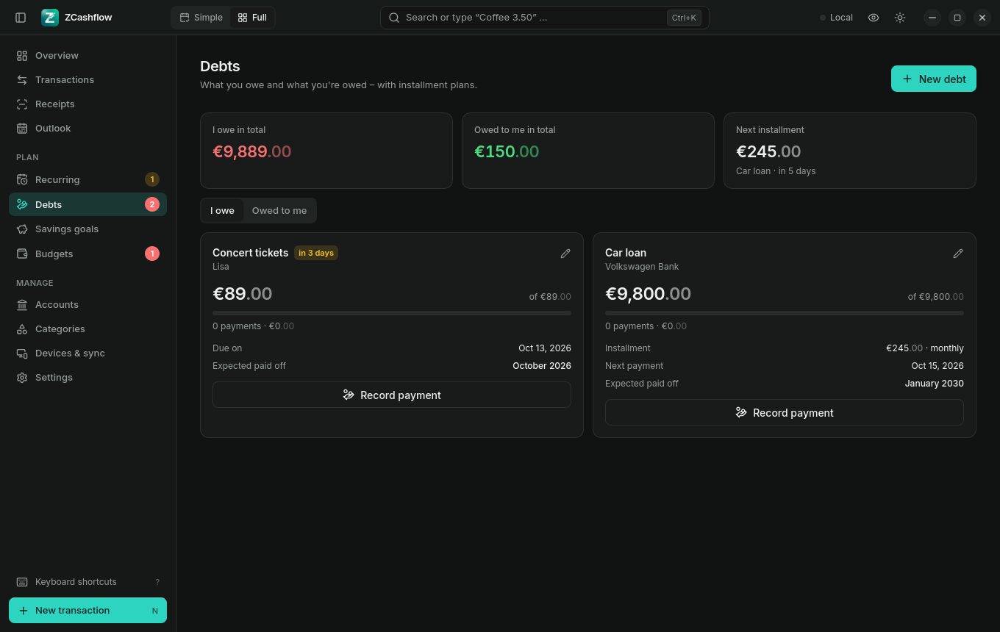<br/><sub><b>Debts</b> – installments and payoff date</sub></td>
<td>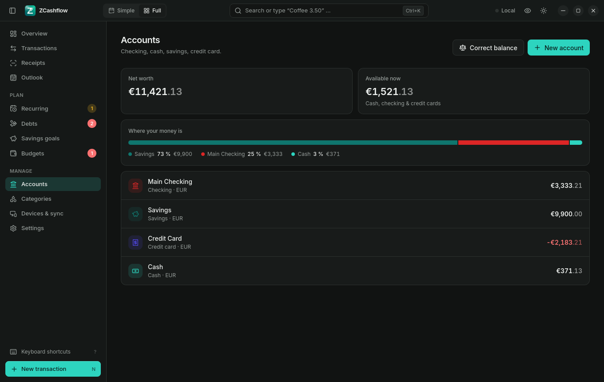<br/><sub><b>Accounts</b> – distribution and balance correction</sub></td>
</tr>
<tr>
<td>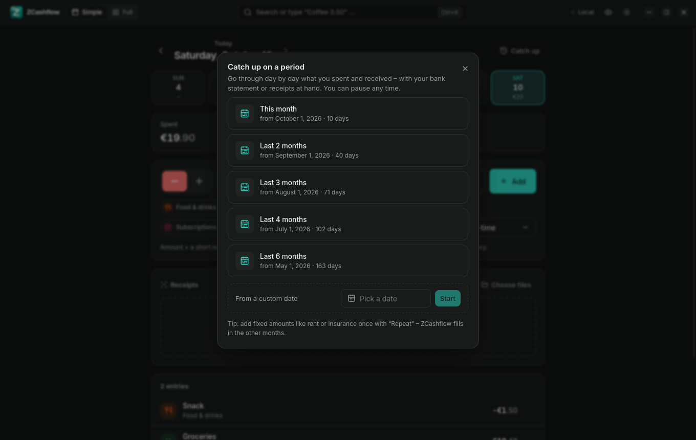<br/><sub><b>Catch up</b> – fill in past days one by one</sub></td>
<td>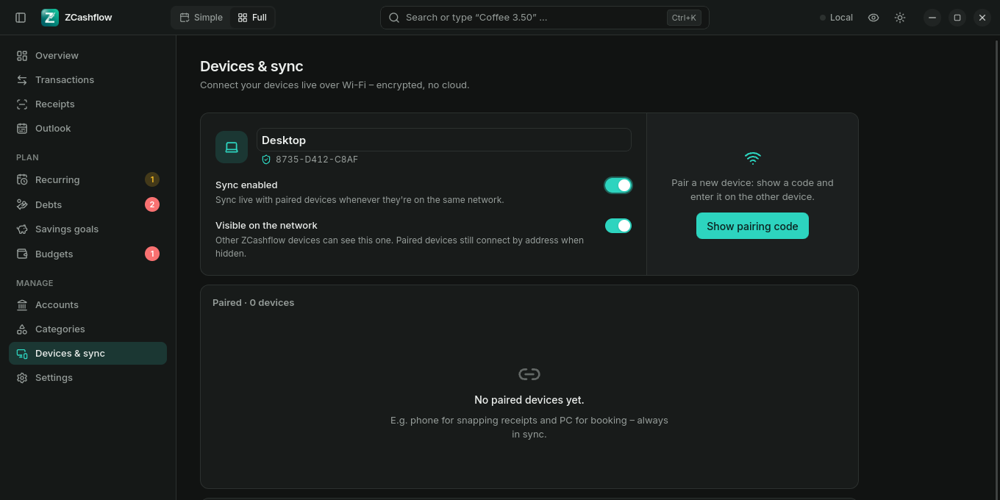<br/><sub><b>Devices & sync</b> – encrypted LAN sync</sub></td>
</tr>
<tr>
<td>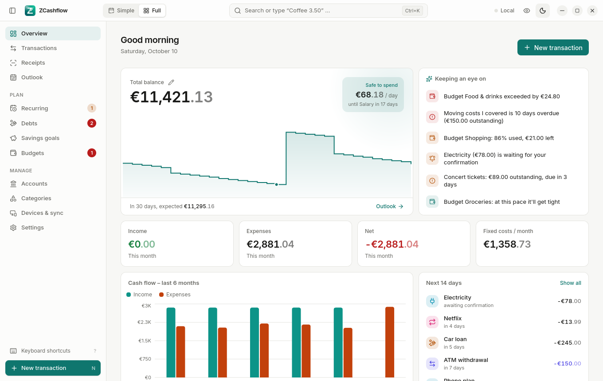<br/><sub><b>Light theme</b></sub></td>
<td>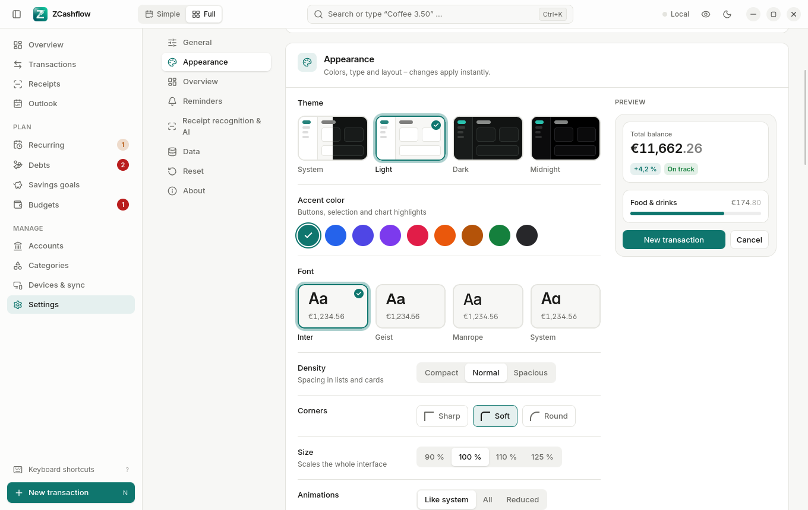<br/><sub><b>Appearance</b> – theme, accent, font, density, size</sub></td>
</tr>
<tr>
<td>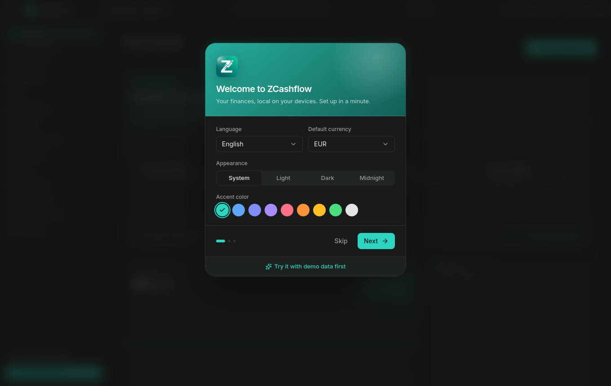<br/><sub><b>Onboarding</b> – set up in a minute, or try demo data</sub></td>
<td>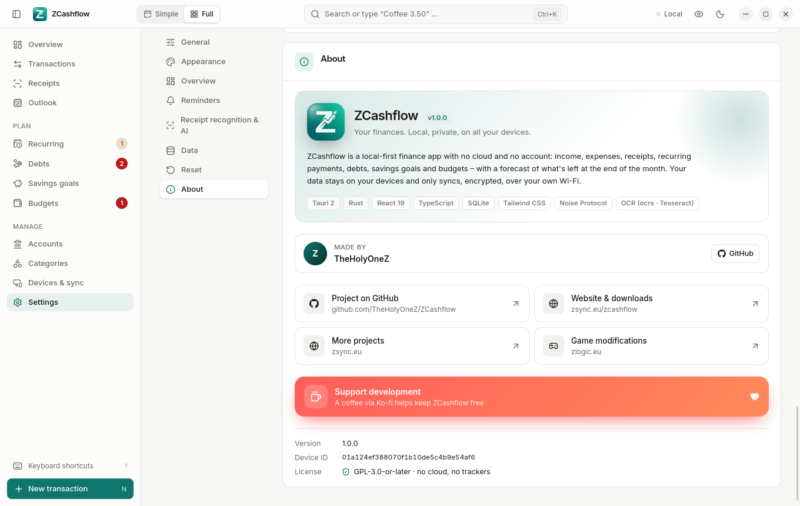<br/><sub><b>About</b></sub></td>
</tr>
</table>

<div align="center">
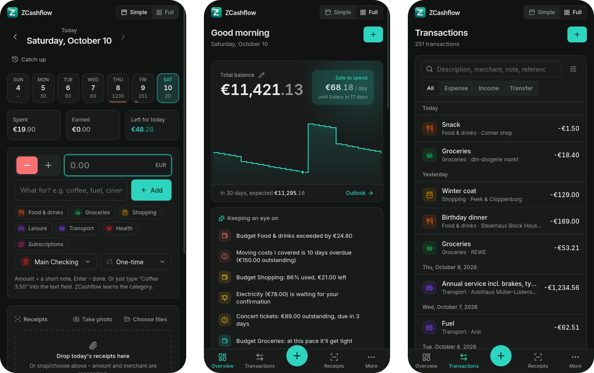
<br/><sub>On the phone: Simple view · Overview · Transactions</sub>
</div>

---

## ⬇ Download

All builds are compiled by GitHub Actions straight from this repository. Get them from the
**[latest release](https://github.com/TheHolyOneZ/ZCashflow/releases/latest)** or from
**[zsync.eu/zcashflow](https://zsync.eu/zcashflow/)**.

| Platform | File | Notes |
|---|---|---|
| 🪟 **Windows 10 / 11** (x64) | `ZCashflow_<version>_windows_x64-setup.exe` | Installer, no admin rights needed |
| 🍎 **macOS 11+** (Apple Silicon M1–M4) | `ZCashflow_<version>_macos_apple-silicon.dmg` | Not notarized → [one extra step](#-macos-apple-silicon) |
| 🐧 **Debian / Ubuntu / Mint / Pop!_OS** | `ZCashflow_<version>_linux_amd64.deb` | |
| 🐧 **Fedora / openSUSE / RHEL** | `ZCashflow_<version>_linux_x86_64.rpm` | |
| 🐧 **Any Linux** (Arch, EndeavourOS, Manjaro, …) | `ZCashflow_<version>_linux_x86_64.AppImage` | Portable, no installation |
| 🤖 **Android 7+** | `ZCashflow_<version>_android.apk` | Signed, arm64 + armv7 |
| 📱 **iPhone / iPad** | `ZCashflow_<version>_ios_unsigned.ipa` | Free install via SideStore → [guide](#-iphone--ipad-ios) |
| 🔐 Checksums | `SHA256SUMS.txt` | [How to verify](#-verify-your-download) |

> **Which Linux file?** Debian-based → `.deb`, Fedora/openSUSE → `.rpm`, everything else (or if you're unsure) → `.AppImage`.

---

## 📦 Installation

### 🪟 Windows

1. Download `ZCashflow_<version>_windows_x64-setup.exe`.
2. Double-click it. Choose your language and click through the installer – it installs for your user only, no administrator rights required.
3. **"Windows protected your PC" (SmartScreen)?** The installer isn't signed with a paid code-signing certificate yet. Click **More info → Run anyway**.
4. Start ZCashflow from the Start menu.

When you first use sync, Windows asks whether ZCashflow may communicate on networks – allow **Private networks**.

Uninstall: *Settings → Apps → Installed apps → ZCashflow → Uninstall*.

> WebView2 is required and already part of Windows 10 (21H2+) and 11. On older systems the installer downloads it automatically.

### 🍎 macOS (Apple Silicon)

1. Download `ZCashflow_<version>_macos_apple-silicon.dmg`, open it and drag **ZCashflow** into **Applications**.
2. The app isn't notarized by Apple (that requires a paid developer account), so macOS blocks the first start. Open **Terminal** and run:
   ```sh
   xattr -cr /Applications/ZCashflow.app
   ```
3. Start ZCashflow normally.

<details>
<summary><b>Alternative without Terminal</b></summary>

Try to open ZCashflow once (it gets blocked), then go to **System Settings → Privacy & Security**, scroll down and click **Open Anyway** next to the ZCashflow message. Confirm with your password.
If macOS says the app *"is damaged and can't be opened"*, use the `xattr` command above – this message is shown for every unsigned download, the app is not actually damaged.
</details>

When you first use sync, allow incoming connections if macOS asks.

> Intel Macs are not covered by the prebuilt download. You can [build it yourself](#-build-from-source) on an Intel Mac.

### 🐧 Linux

**Debian, Ubuntu, Linux Mint, Pop!_OS, Zorin …**
```sh
sudo apt install ./ZCashflow_<version>_linux_amd64.deb
```

**Fedora, openSUSE, RHEL, Rocky, Alma …**
```sh
sudo dnf install ./ZCashflow_<version>_linux_x86_64.rpm      # Fedora / RHEL
sudo zypper install ./ZCashflow_<version>_linux_x86_64.rpm   # openSUSE
```

**Arch, EndeavourOS, Manjaro and every other distribution – AppImage**
```sh
chmod +x ZCashflow_<version>_linux_x86_64.AppImage
./ZCashflow_<version>_linux_x86_64.AppImage
```
<details>
<summary><b>AppImage tips</b></summary>

- If it doesn't start, install FUSE 2: `sudo pacman -S fuse2` (Arch) · `sudo apt install libfuse2` (Debian/Ubuntu 22.04) · `sudo apt install libfuse2t64` (Ubuntu 24.04+).
- To get a menu entry, use [Gear Lever](https://flathub.org/apps/it.mijorus.gearlever) or [AppImageLauncher](https://github.com/TheAssassin/AppImageLauncher), or move the file to `~/Applications`.
- Runtime dependencies (usually preinstalled on desktops): `webkit2gtk-4.1`, `gtk3`, `libayatana-appindicator` (optional).
</details>

**Firewall (needed for sync).** Most desktop distributions block incoming connections. Allow the sync port once:
```sh
sudo firewall-cmd --permanent --add-port=47811/tcp && sudo firewall-cmd --reload   # Fedora, EndeavourOS, openSUSE (firewalld)
sudo ufw allow 47811/tcp                                                            # Ubuntu, Mint (ufw)
```
ZCashflow shows exactly these commands, with a copy button, under *Devices & sync*.

### 🤖 Android

1. Open the release page on your phone and download `ZCashflow_<version>_android.apk`.
2. Tap the downloaded file. Android asks whether your browser/file manager may **install unknown apps** – allow it once.
3. Tap **Install**. If **Google Play Protect** shows a warning ("unknown developer"), choose **More details → Install anyway**. The APK is signed; the warning only appears because the app isn't distributed through the Play Store.
4. Open ZCashflow.

**Updating:** install the newer APK over the old one – your data stays. (All releases are signed with the same key.)

**Receipts:** *Take photo* uses the camera; Android asks for permission the first time.

### 📱 iPhone & iPad (iOS)

Apple only allows apps from the App Store – unless you **sideload** them with your own Apple ID. That's free and works with any Apple ID, but a free Apple ID signs apps for **7 days**. **SideStore** takes care of that: it renews the signature automatically in the background, on the phone itself. After the one-time setup below, you don't need a computer anymore.

> ⏱ The setup takes about 15 minutes, once. You need: your iPhone/iPad, a USB cable, a computer (Windows, macOS or Linux) and an Apple ID.

<details open>
<summary><b>Step 1 – Prepare an Apple ID</b></summary>

- You can use your normal Apple ID. Nothing in your iCloud changes – the app is only *signed* with it.
- Don't know your Apple ID email? On the iPhone: **Settings → [your name]** – the email under your name is your Apple ID.
- Don't know the password? **Settings → [your name] → Sign-In & Security → Change Password** – you only need your iPhone passcode.
- Prefer a separate Apple ID? Create one at [account.apple.com](https://account.apple.com). You can use the same phone number as for your main Apple ID.
</details>

<details open>
<summary><b>Step 2 – Install SideStore with iloader (on your computer)</b></summary>

[**iloader**](https://github.com/nab138/iloader) installs SideStore and sets up everything it needs (pairing file, certificate).

1. Install iloader:
   - **Windows / macOS:** download it from the [iloader releases](https://github.com/nab138/iloader/releases).
     On Windows also install [iTunes](https://www.apple.com/itunes/) (or *Apple Devices* from the Microsoft Store) so the iPhone is recognized over USB.
   - **Linux:** install `usbmuxd` first, then iloader – e.g. on Arch/EndeavourOS:
     ```sh
     sudo pacman -S usbmuxd
     yay -S iloader-bin
     ```
     (Other distributions: `sudo apt install usbmuxd` / `sudo dnf install usbmuxd`, then the AppImage/package from the iloader releases.)
2. Connect the iPhone with the USB cable, unlock it and tap **Trust** on *"Trust This Computer?"* (enter your passcode).
3. Open iloader and **sign in with your Apple ID**. Enter the verification code that appears on your iPhone.
4. Click **Install SideStore** and wait until iloader reports success (1–3 minutes). The **SideStore** icon appears on your home screen.
</details>

<details open>
<summary><b>Step 3 – Allow SideStore on the iPhone</b></summary>

These menu items only appear **after** SideStore has been installed:

1. **Settings → Privacy & Security →** scroll to the very bottom **→ Developer Mode → On** (iOS 16 and newer; on older versions skip this step). The iPhone restarts; after the restart tap **Turn On** and enter your passcode.
2. **Settings → General → VPN & Device Management →** tap your Apple ID **→ Trust**.
3. Install **LocalDevVPN** from the App Store (free – just search for "LocalDevVPN"). SideStore needs it to install and refresh apps directly on the phone. Open it once and tap **Connect** (allow the VPN configuration). It's a local loopback – no traffic leaves your phone.
4. Open **SideStore** and sign in with the **same Apple ID**.
</details>

<details open>
<summary><b>Step 4 – Install ZCashflow</b></summary>

1. On the iPhone, open the release page in Safari and download `ZCashflow_<version>_ios_unsigned.ipa` (it lands in **Files → Downloads**). Alternatively send it to yourself via AirDrop, a messenger or a cloud drive and **save it to Files**.
2. Make sure **LocalDevVPN is connected** (VPN icon in the status bar).
3. Open **SideStore → My Apps → +** (top left) and pick the `.ipa`.
4. After a few seconds ZCashflow is on your home screen. 🎉
</details>

<details>
<summary><b>Updating, refreshing & limits</b></summary>

- **Refresh:** SideStore renews the 7-day signature in the background over Wi-Fi as long as LocalDevVPN can connect. You can also open SideStore and tap **Refresh All** at any time. If an app expires, it doesn't lose data – just refresh it.
- **Update ZCashflow:** download the new `.ipa` and install it the same way (*My Apps → +*). Your data stays.
- **Limits of a free Apple ID:** up to 3 sideloaded apps at once (SideStore counts as one), signatures last 7 days (renewed automatically).
- **Sync on iPhone:** sideloaded apps can't use Bonjour. ZCashflow therefore scans your Wi-Fi directly – allow **Local Network** access when iOS asks. See [Sync](#-sync-between-devices).
</details>

<details>
<summary><b>iOS troubleshooting</b></summary>

| Problem | Fix |
|---|---|
| *Developer Mode* / your Apple ID under *VPN & Device Management* is missing | SideStore isn't installed yet – finish step 2 (iloader must report success). |
| iloader doesn't see the iPhone | Unlock it, tap *Trust*, try another cable/port. Linux: `sudo systemctl start usbmuxd`. Windows: install iTunes / Apple Devices. |
| SideStore: *"VPN Connection Error: No utun interface detected – LocalDevVPN is not connected"* | Open LocalDevVPN and tap **Connect**, then try again in SideStore. |
| *"Untrusted Developer"* when opening ZCashflow | Settings → General → VPN & Device Management → your Apple ID → Trust. |
| App won't open after a week | The signature expired. Connect LocalDevVPN, open SideStore → **Refresh All**. |
| *"Maximum number of apps"* | A free Apple ID allows 3 sideloaded apps – remove one in SideStore. |
</details>

### 🔐 Verify your download

Every release contains `SHA256SUMS.txt`. Compare the checksum of your file with the one listed:

```sh
sha256sum ZCashflow_*            # Linux
shasum -a 256 ZCashflow_*        # macOS
```
```powershell
Get-FileHash .\ZCashflow_*.exe -Algorithm SHA256   # Windows PowerShell
```

---

## 🚀 First steps

1. **Onboarding** – choose language, currency, theme and accent color, enter your current balances (as of *today*) and, optionally, salary and rent. Or click **Try it with demo data first** to explore six months of sample data (remove it later under *Settings → Data*).
2. **Pick your style** – *Simple* for a quick daily routine, *Full* for every section. Switch any time in the title bar (on phones: top right).
3. **Add your fixed costs once** – rent, subscriptions, insurance, salary under *Recurring* (or with *Repeat* right in the quick entry). From then on they're booked automatically and appear in the forecast.
4. **Starting mid-month?** Use **Catch up** in the Simple view to go through the past days one by one – with your bank statement or receipts next to you.
5. **Balance off?** Click the ✏️ next to *Total balance* and type what your banking app says. Past entries stay as history and no longer change today's balance.

---

## 🔗 Sync between devices

ZCashflow syncs directly between your devices – no server involved. Connections are authenticated and encrypted with the **Noise protocol** (`XX` handshake, pairing uses a pre-shared code); only paired devices can exchange data.

**Pair two devices (e.g. iPhone ↔ PC):**

1. Both devices on the **same Wi-Fi**, ZCashflow open on both.
2. On the PC, make sure the firewall allows port **47811/tcp** (see [Linux](#-linux); Windows/macOS ask on first use).
3. On the phone open **Devices & sync**. The PC appears under *On this network* within a few seconds (tap **Search** if not).
4. Tap **Pair**. The PC immediately shows a window *"iPhone wants to connect"* with a **6-digit code**.
5. Type the code on the phone – done. Both show **Live**, and every change appears on the other device within seconds.

From then on, devices reconnect automatically whenever they're on the same network – also after restarts or IP changes, and as soon as the app comes back to the foreground on the phone.

**Roles:** per paired device you can choose *Full access*, *Read only* (sees everything, can't change anything) or *Receipts only* (may only send receipt photos – handy for a family member's phone).

<details>
<summary><b>Pairing manually by address</b></summary>

If automatic discovery doesn't find the other device (e.g. guest networks with client isolation), use **By address**: type the IP shown on the other device under *This device is reachable at* (e.g. `192.168.1.23` or `192.168.1.23:47811`) and tap **Request code**.
</details>

---

## 🧾 Receipts, OCR & local AI

- **Built-in OCR** (`ocrs`) works offline on every platform, no setup needed.
- **Tesseract** (desktop, optional) is used automatically when installed and is often more accurate:
  - Debian/Ubuntu: `sudo apt install tesseract-ocr tesseract-ocr-deu`
  - Fedora: `sudo dnf install tesseract tesseract-langpack-deu`
  - Arch: `sudo pacman -S tesseract tesseract-data-deu tesseract-data-eng`
  - macOS: `brew install tesseract tesseract-lang`
  - Windows: [UB Mannheim installer](https://github.com/UB-Mannheim/tesseract/wiki) (tick the languages you need)
- **Local AI refinement** (optional): run [Ollama](https://ollama.com) or [LM Studio](https://lmstudio.ai), then enable it under *Settings → Receipt recognition & AI* (default address `http://localhost:11434`). Pick a model; vision models like `qwen2.5vl` or `llava` can read the photo directly. Your data never leaves your machine.

---

## 💾 Your data

| | Location |
|---|---|
| Windows | `%APPDATA%\dev.zcashflow.app\` |
| macOS | `~/Library/Application Support/dev.zcashflow.app/` |
| Linux | `~/.local/share/dev.zcashflow.app/` |
| Android / iOS | App sandbox (removed when the app is uninstalled) |

- `zcashflow.db` – the SQLite database; `attachments/` – receipt photos.
- **Backup:** *Settings → Data → Save backup* writes a complete copy of the database. **Export:** *Settings → Data → Export data* saves all data or a selection as CSV (several selections as one ZIP). **Import:** *Import CSV* reads the ZCashflow template or a bank export and shows a preview first.
- **Reset:** *Settings → Reset* resets the appearance or deletes everything (optionally saving a backup first).
- Syncing devices is *not* a backup – deleting on one device deletes everywhere. Keep a backup.

---

## ⌨ Keyboard shortcuts

| Shortcut | Action |
|---|---|
| <kbd>Ctrl</kbd>/<kbd>⌘</kbd> + <kbd>K</kbd> | Search & quick entry (`Coffee 3.50`) |
| <kbd>N</kbd> | New transaction |
| <kbd>Ctrl</kbd>/<kbd>⌘</kbd> + <kbd>1</kbd> … <kbd>9</kbd> | Jump to section |
| <kbd>Ctrl</kbd>/<kbd>⌘</kbd> + <kbd>B</kbd> | Toggle sidebar |
| <kbd>Ctrl</kbd>/<kbd>⌘</kbd> + <kbd>,</kbd> | Settings |
| <kbd>Ctrl</kbd>/<kbd>⌘</kbd> + <kbd>Shift</kbd> + <kbd>H</kbd> | Hide / show all amounts |
| <kbd>F11</kbd> | Full screen (desktop) |
| <kbd>?</kbd> | Show all shortcuts |

---

## 🛠 Build from source

**Stack:** [Tauri 2](https://tauri.app) (Rust) · React 19 · TypeScript · Vite · Tailwind CSS 4 · TanStack Router & Query · Zustand · i18next · SQLite (rusqlite) · Noise protocol (`snow`) · mDNS · `ocrs`.

### Prerequisites

| | |
|---|---|
| **Rust** | stable, via [rustup](https://rustup.rs) |
| **Node.js** | 22+ and **pnpm** 10 (`npm i -g pnpm` or `corepack enable`) |
| **Linux** | `webkit2gtk-4.1`, `gtk3`, `librsvg`, `patchelf`, build tools – e.g. Debian/Ubuntu:<br/>`sudo apt install libwebkit2gtk-4.1-dev libappindicator3-dev librsvg2-dev patchelf build-essential curl wget file libssl-dev`<br/>Arch: `sudo pacman -S webkit2gtk-4.1 base-devel curl wget file openssl appmenu-gtk-module libappindicator-gtk3 librsvg` |
| **Windows** | [Microsoft C++ Build Tools](https://visualstudio.microsoft.com/visual-cpp-build-tools/) ("Desktop development with C++") and WebView2 (preinstalled on Windows 10/11) |
| **macOS** | Xcode Command Line Tools: `xcode-select --install` |

See the [Tauri prerequisites](https://tauri.app/start/prerequisites/) for details.

### Run & build

```sh
git clone https://github.com/TheHolyOneZ/ZCashflow.git
cd ZCashflow
pnpm install

pnpm tauri dev          # run in development mode (hot reload)
pnpm tauri build        # release build → src-tauri/target/release/bundle/
```

Useful extras:
```sh
pnpm test                         # frontend tests (vitest)
pnpm typecheck                    # TypeScript
cd src-tauri && cargo test        # backend tests
cd src-tauri && cargo clippy --all-targets -- -D warnings
ZC_DATA_DIR=/tmp/zc pnpm tauri dev   # use a separate data folder (e.g. to run two instances side by side)
```

### Android

Requirements: Android SDK + NDK 27, JDK 17, `ANDROID_HOME` / `NDK_HOME` / `JAVA_HOME` set, and the Rust targets:
```sh
rustup target add aarch64-linux-android armv7-linux-androideabi
pnpm tauri android init
pnpm android:setup                 # permissions + Wi-Fi multicast lock for sync
pnpm tauri android build --apk --target aarch64 --target armv7
```
The APK lands in `src-tauri/gen/android/app/build/outputs/apk/universal/release/`. To sign it, put your keystore at `src-tauri/gen/android/release.jks` and a `keystore.properties` (`keyAlias`, `password`, `storeFile`) next to it before building.

### iOS (macOS + Xcode)

```sh
rustup target add aarch64-apple-ios aarch64-apple-ios-sim
pnpm tauri ios init
pnpm tauri ios dev                 # simulator or connected device
```
For an unsigned IPA (to sideload), see the `ios` job in [`.github/workflows/build.yml`](.github/workflows/build.yml) – `scripts/ios-unsigned.py` disables code signing in the generated Xcode project.

### Releases via GitHub Actions

You don't need every toolchain locally – GitHub builds everything:

- **CI** (`.github/workflows/ci.yml`) runs typecheck, tests, build, `cargo test` and clippy on every push.
- **Build** (`.github/workflows/build.yml`):
  - *Actions → Build → Run workflow* builds selected platforms as artifacts.
  - Pushing a version tag builds **all** platforms and creates a **draft release** with consistently named files and `SHA256SUMS.txt`:
    ```sh
    git tag v1.3.0 && git push origin v1.3.0
    ```
  - Android signing uses the repository secrets `ANDROID_KEYSTORE_B64` (base64 of the keystore) and `ANDROID_KEY_PASSWORD`.

### Project structure

```
src/                     React frontend
  app/                   shell, title bar, router, command palette, shortcuts
  features/              one folder per area (today, transactions, receipts, recurring, debts,
                         goals, budgets, accounts, devices, settings, onboarding, …)
  components/            shared UI (selects, dialogs, inputs, charts)
  locales/               de, en, es, fr, it, pl, tr
src-tauri/               Rust backend
  src/domain/            business logic (transactions, recurring, forecast, insights, …)
  src/sync/              LAN sync: discovery, pairing, Noise channel, row replication
  src/ocr/               OCR engines and receipt parsing
  migrations/            SQLite schema migrations
scripts/                 Android/iOS build helpers
docs/                    screenshots, mobile notes, roadmap
```

---

## ❓ FAQ & troubleshooting

<details>
<summary><b>Is ZCashflow really free? Where's the catch?</b></summary>

It's free and open source under the GPL-3.0. There's no account, no subscription, no ads and no data collection. If you like it, you can [buy me a coffee on Ko-fi](https://ko-fi.com/theholyonez).
</details>

<details>
<summary><b>Can ZCashflow connect to my bank?</b></summary>

No – by design. Banking APIs require a cloud service in between. You enter transactions yourself (it takes seconds with quick entry and *Again* chips) or let receipts fill them in. The *Correct balance* button keeps your balance in line with your bank.
</details>

<details>
<summary><b>The two devices don't find each other</b></summary>

- Same Wi-Fi? Guest networks often isolate devices – use your main network.
- PC firewall: allow port **47811/tcp** (*Devices & sync* shows the exact command on Linux).
- iPhone: allow **Local Network** access (*Settings → Privacy & Security → Local Network → ZCashflow*).
- Still nothing? Use **By address** with the IP shown on the other device.
- *"update both devices"*: both devices need the same ZCashflow version – update the older one.
</details>

<details>
<summary><b>My balance is wrong after catching up on past days</b></summary>

Click the ✏️ next to *Total balance* (or *Accounts → Correct balance*) and enter today's real balance. From then on, entries before that date are history and don't change today's balance.
</details>

<details>
<summary><b>Windows SmartScreen / macOS Gatekeeper / Play Protect warn me</b></summary>

The builds are not signed with paid certificates (Apple Developer Program, Windows code-signing). The warnings are expected; follow the steps in [Installation](#-installation). You can [verify the checksums](#-verify-your-download) or build the app yourself.
</details>

<details>
<summary><b>How do I move to a new computer?</b></summary>

Either pair the new device with an existing one (everything syncs over), or copy a backup: *Settings → Data → Save backup* on the old device, then replace `zcashflow.db` in the [data folder](#-your-data) of the new one while ZCashflow is closed.
</details>

---

## 🤝 Contributing

Bug reports, ideas and translations are welcome – please open an [issue](https://github.com/TheHolyOneZ/ZCashflow/issues).
For code changes: fork, create a branch, make sure `pnpm typecheck`, `pnpm test`, `cargo test` and `cargo clippy -- -D warnings` pass, and open a pull request.

**Translations** live in `src/locales/*.json`. Copy `en.json`, translate the values (keep `{{placeholders}}` and the plural suffixes `_one`/`_other`, plus `_few`/`_many` where your language needs them), and register it in `src/lib/i18n.ts`. `pnpm test` checks completeness automatically.

---

## 📜 License, author & support

ZCashflow is free software, licensed under the **[GNU General Public License v3.0 or later](LICENSE)**.

<div align="center">

Made with ❤️ by **[TheHolyOneZ](https://github.com/TheHolyOneZ)**

[🌐 More projects – zsync.eu](https://zsync.eu) · [🎮 Game modifications – zlogic.eu](https://zlogic.eu/) · [☕ Support on Ko-fi](https://ko-fi.com/theholyonez)

<a href="https://ko-fi.com/theholyonez"></a>

</div>
